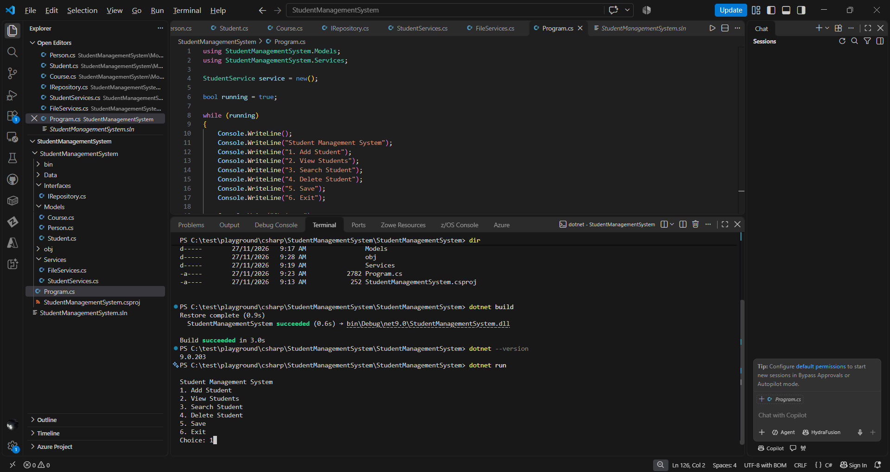
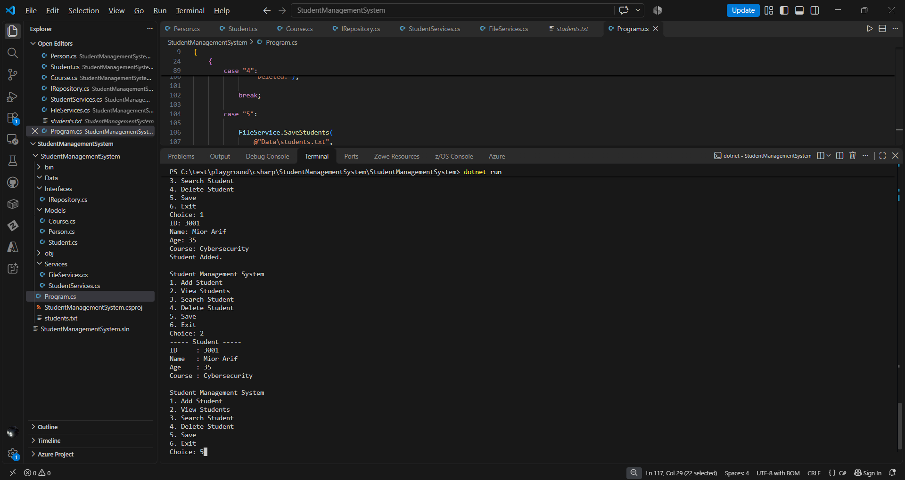
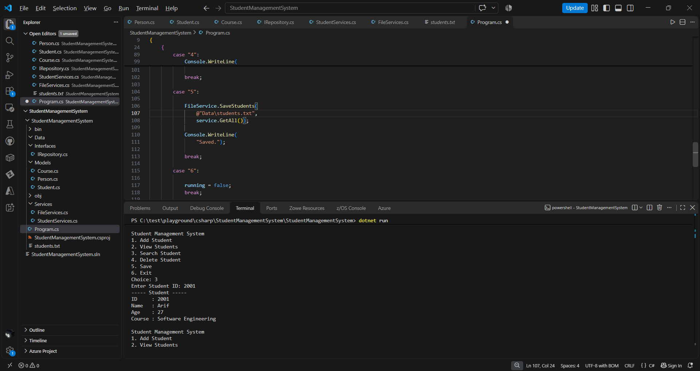
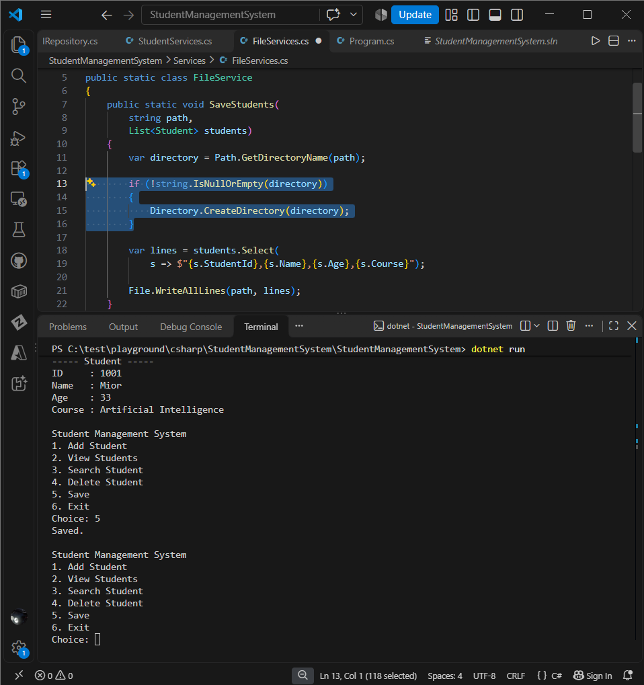
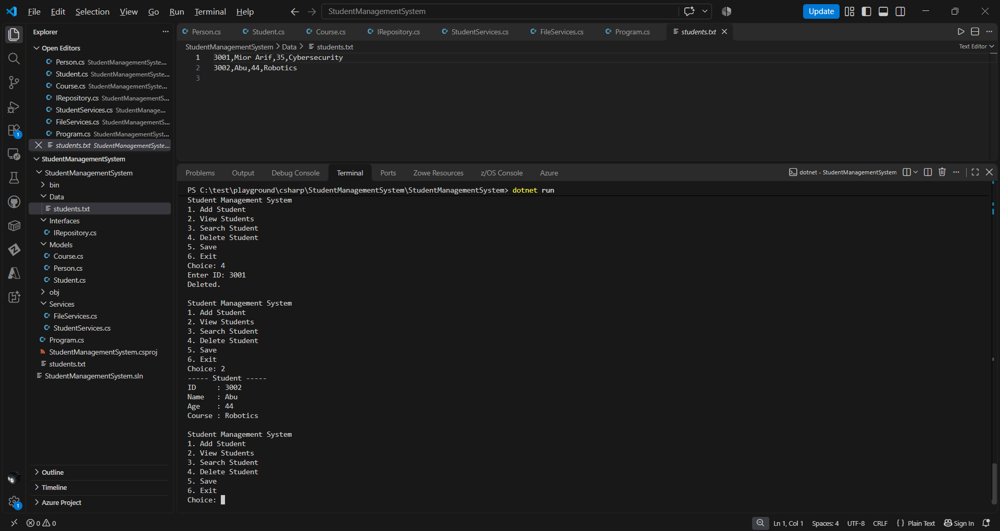

# studmgmtsys 🧑‍🎓#️⃣
studmgmtsys : | Student Management System | C#, .NET Console Application, OOP, Inheritance, Interfaces, Encapsulation, Collections, LINQ, Exception handling, File persistence |

## Objectives
- Build & demo a C# fundamentals code
- Familiarize with Software Engineering Basics (.net environment)

## Student Management System

